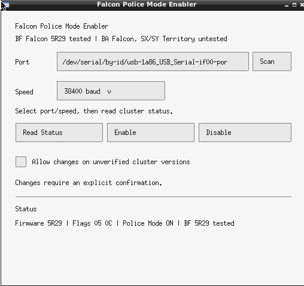
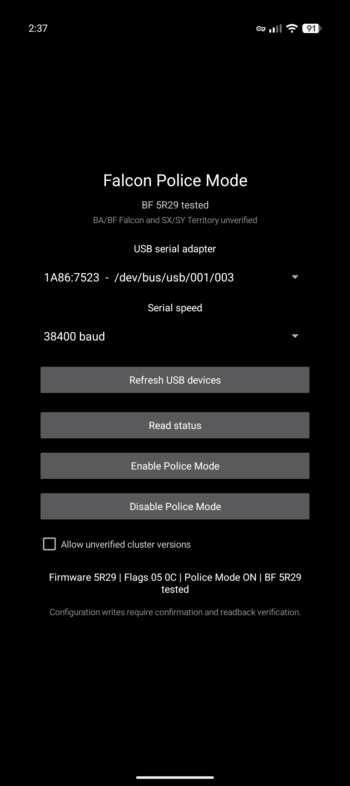

# B-Series Falcon Police Mode Enabler

A small, open-source Police Mode utility for Ford B-series instrument clusters. Available as a Linux GUI, Linux CLI and Android app. The diagnostic protocol is written in C and shared by all three versions.

## What is Police Mode?

Police Mode is a factory instrument-cluster setting found in BA/BF Falcons and related vehicles. It changes the cluster's display behaviour:

- Shows a **digital speedometer** on the right-hand LCD.
- Lets you **freeze the displayed speed** using the Trip button, then return to live speed by holding the Trip button for 3 seconds.
- Changes the available trip-computer displays. On supported low-series clusters, Trip B and some trip-computer functions are unavailable while Police Mode is enabled; distance-to-empty and Trip A remain available.

**Police Mode only changes the instrument cluster configuration.** It does **not** change the engine ECU, engine power, tuning, transmission behaviour or maximum-speed limiter.

This tool reads the current cluster settings, changes only the Police Mode bit when requested, and checks the result afterward. You can enable or disable it.

## Compatibility

| Item | Status |
| --- | --- |
| 2006 BF Falcon E-Gas, cluster firmware `5R29` | **Tested**; Police Mode enable/readback verified |
| USB ELM327 v1.5 adapter with CH340 serial chip, 38400 baud | **Tested** |
| Google Pixel 9 running GrapheneOS, using the adapter over USB-C OTG | **Android app tested** |
| BA Falcon, SX/SY Territory | **Untested**; expected to use a compatible cluster protocol |
| Other BF firmware revisions and USB adapters | Not yet verified, but should work |

The application requires an ELM327-compatible USB diagnostic adapter. Android requires a USB host/OTG connection. Other adapters and vehicles may behave differently.

**Use at your own risk.** An interrupted or incompatible configuration write could cause instrument-cluster problems. Keep the vehicle stationary, maintain stable battery voltage and read its current status before making changes. Writes to unrecognised firmware are blocked by default unless explicitly overridden.

## Downloads

Download the ready-to-run Linux applications and Android APK from [GitHub Releases](https://github.com/Magg27/B-Series-Falcon-Police-Mode-Enabler/releases).

The repository contains source files and build scripts.

## Using the tool

**Linux GUI:** Connect the ELM327 to your computer and the Falcon's OBD-II port with the ignition on (reds). Run `pme-gui`, choose the serial port and baud rate, then select **Read Status**. Confirm the result before enabling or disabling Police Mode.
 

**Android:** Connect the ELM327 to your phone via USB-C OTG adapter, then plug the ELM327 into the Falcon's OBD-II port with the ignition on (reds). Open the app, select the USB device and baud rate, grant USB permission, then select **Read Status**.
 
 
**Linux CLI:**
Connect the ELM327 to your computer and the Falcon's OBD-II port with the ignition on (reds).

```bash
./bin/pme-cli --list
./bin/pme-cli --port /dev/ttyUSB0 --baud 38400 --read
./bin/pme-cli --port /dev/ttyUSB0 --baud 38400 --enable
./bin/pme-cli --port /dev/ttyUSB0 --baud 38400 --disable
```

Replace `/dev/ttyUSB0` with your actual device. Enable and disable operations require explicit confirmation.

## Build on Linux

Install build dependencies:

**Arch Linux / CachyOS:**

```bash
sudo pacman -Syu --needed base-devel libx11 git
```

**Debian / Ubuntu:**

```bash
sudo apt update
sudo apt install build-essential libx11-dev git
```

Build and test:

```bash
git clone https://github.com/Magg27/B-Series-Falcon-Police-Mode-Enabler.git
cd B-Series-Falcon-Police-Mode-Enabler
make clean all test
./bin/pme-gui
```

Build outputs: `bin/pme-gui` and `bin/pme-cli`. The GUI uses X11/XWayland.

If the serial port is inaccessible on Arch, check its group with `ls -l /dev/ttyUSB0`; the group is commonly `uucp`. Add your user with `sudo usermod -aG uucp "$USER"`, then log out and back in. Other distributions commonly use `dialout`.

## Build for Android

Requirements: **JDK 21**, Android SDK **35**, Build Tools **35.0.0**, NDK **27.0.12077973**, and CMake **3.22.1**. Install the SDK through [Android Studio](https://developer.android.com/studio) or the [Android command-line tools](https://developer.android.com/studio#command-tools).

On Arch, install host dependencies:

```bash
sudo pacman -S --needed jdk21-openjdk curl unzip android-tools
```

With the SDK installed at `~/Android/Sdk`, run from the repository root:

```bash
export ANDROID_HOME="$HOME/Android/Sdk"
unset ANDROID_SDK_ROOT

"$ANDROID_HOME/cmdline-tools/latest/bin/sdkmanager" --sdk_root="$ANDROID_HOME" --licenses
"$ANDROID_HOME/cmdline-tools/latest/bin/sdkmanager" --sdk_root="$ANDROID_HOME" \
  'platforms;android-35' 'build-tools;35.0.0' 'platform-tools' \
  'ndk;27.0.12077973' 'cmake;3.22.1'

bash android/build-android.sh
```

The build script downloads Gradle when needed. The resulting **debug APK** is at:

```text
android/app/build/outputs/apk/debug/app-debug.apk
```

To install it on a connected Android device with USB debugging enabled:

```bash
adb devices
adb install -r android/app/build/outputs/apk/debug/app-debug.apk
```

## Credits

Inspired by the original **Windows B Series Police Mode Enabler** by **Matt (`aumatt`)**, first shared on the [Fordmods forum](https://www.fordmods.com/fordmods-technical-documents-diy-f38/b-series-police-mode-enabler-t104886.html). in June 2011.

This project is an independent Linux/Android implementation. It does not distribute the original Windows executable and is not affiliated with, endorsed by, or associated with Ford Motor Company, their suppliers, or any of the semiconductor manufacturers.

## Licence

GPL-3.0. See [LICENSE](LICENSE).
